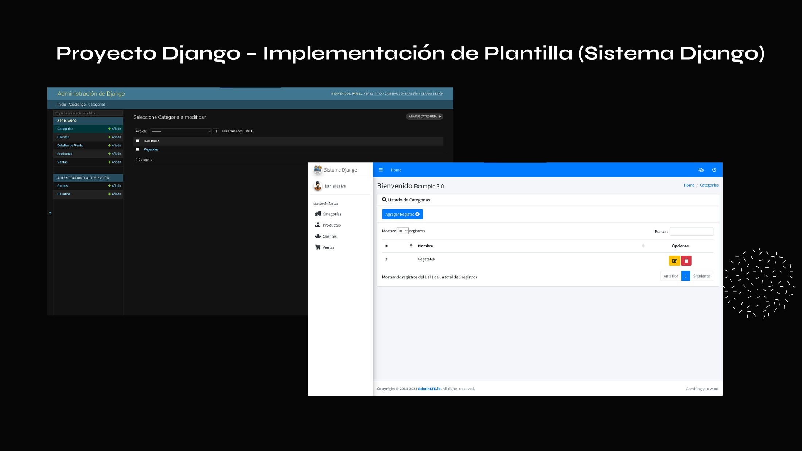

# Sistema CRUD — Django y AdminLTE

Aplicación web desarrollada con **Django** y la plantilla **AdminLTE 3.2.0** para la gestión administrativa de categorías, productos, clientes, ventas y detalle de ventas.

## Vista previa

## Características principales

- **Gestión de Categorías:** Vistas basadas en clases (`ListView`, `CreateView`, `UpdateView`, `DeleteView`) integradas con plantillas AdminLTE y consultas AJAX/JSON.
- **Modelos comerciales:** Definición y registro en **Django Admin** de `Categoria`, `Producto`, `Cliente`, `Venta` y `DetalleVenta`.
- **Interfaz administrativa:** Plantilla base basada en **AdminLTE 3.2.0** con barra superior, menú lateral y tablas de listado.

## Tecnologías utilizadas

- **Python 3.10**
- **Django 4.1.5** y **django-widget-tweaks**
- **SQLite** (base de datos por defecto; `db.py` incluye bloques de ejemplo para PostgreSQL y MySQL)
- **AdminLTE 3.2.0** (Bootstrap, jQuery, DataTables y Font Awesome)

## Contexto y estado del proyecto

- **Contexto:** Proyecto académico de práctica con Django y AdminLTE que conserva su implementación original (modo `DEBUG = True` y configuración de demostración en `settings.py` y `db.py`). **No está preparado para entornos de producción.**
- **Estado:** Finalizado (archivado para portafolio). El archivo `db.sqlite3` fue excluido mediante `.gitignore`; la base de datos local se genera ejecutando las migraciones de Django (`python manage.py migrate`).

## Autor

**Daniel Alejandro Arita Leiva**
